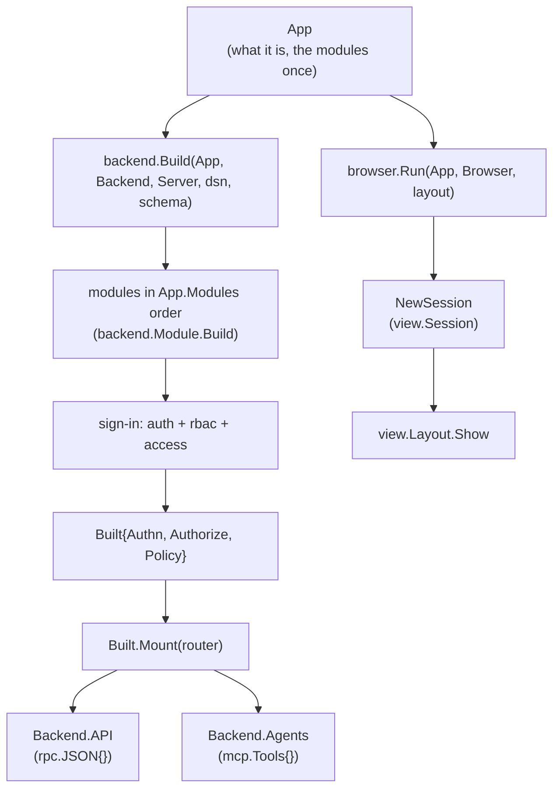

# webtyp/appkit Architecture

## 1. Overview in One Minute

`appkit` is the application kit: the app hands it the list of its modules and the concrete pieces it chose, and it builds the app for the server, the Worker and the browser. It owns no driver, transport, id generator, broker or HTTP server, and no layout: it asks for them by contract (`storage.Conn`, `appkit.API`, `appkit.Agents`, `events.Broker`, `view.Layout`).

## 2. Files

**Why three packages:** the import graph decides what enters each binary (`appkit` shared, `appkit/backend` server/Worker, `appkit/browser` browser), without any `browser`/`!browser` build tag.

| File | Package / Tag | Responsibility |
|---|---|---|
| [`app.go`](../app.go) | `appkit` | `App` (its `SignIn` lists `auth.Mode` values), shared errors |
| [`backend/backend.go`](../backend/backend.go) | `appkit/backend` | `Backend`, `Module`, `Server`, `API`, `Agents`, `Parts`, `Deps`, `FindBuiltModule` |
| [`backend/build.go`](../backend/build.go) | `appkit/backend` | `Build`, `Built.Mount`, `BuildModules`, leftovers check |
| [`backend/signin.go`](../backend/signin.go) | `appkit/backend` | The sign-in by trusted IP: users, roles, first administrator, rate limit |
| [`backend/external_calls.go`](../backend/external_calls.go) | `appkit/backend` | Queue adapter, runner and background executor |
| [`browser/browser.go`](../browser/browser.go) | `appkit/browser` | `Browser`, `Module`, `Run`, `NewSession`, `Screens` |
| [`browser/signin.go`](../browser/signin.go) | `appkit/browser` | Login and first-setup screens, users and roles administration |
| [`render_ssr.go`](../render_ssr.go) | `appkit` (`!wasm`) | `App.RenderHTML` |

## 3. Flows

### Build and Mount

1. `Build` checks what the app declared (log, broker, API, ids, one part per listed module and no part for an unlisted one), opens the database, builds each module in `App.Modules` order and adds the `Parts` a module offers.
2. With `App.SignIn` it builds `authority`, `access` and `rbac` **after** the modules, so the optional staff register is found among the built ones; without it every operation is denied and the log says so.
3. `DefaultGrants` are ensured on `rbac.RoleAuthenticated`; the external-calls queue is created and its executor started when a module declares calls.
4. The `main` creates the HTTP server with `built.Authn/Authorize/Policy` and calls `built.Mount`: `Backend.API` publishes the operations (and checks every `Backend.Public` action is offered), `Backend.Agents` the allowed tools, then the extra mounts (dev tools) and `Backend.Routes`.

### External Calls (D58)

`appkit` is the composition root that resolves the import cycle between `crud` and `externalcalls`: `Build` creates the queue on `d.DB`, `NewCallQueue` adapts it to `crud.CallQueue` and registers it with `crud.SetDefaultQueue`, `NewCallRunner` maps `(module, entity, call)` to the declared `model.ExternalCallDefinition`, and `StartCallExecutor` runs pending calls and settles expired `WaitForReply` ones as `failed`.

### Browser

`NewSession` checks the parts (`Browser.Modules`), makes the ids, wraps `Browser.Caller` in `view.NewRecords()` so every screen shares one record cache, and collects the screens in `App.Modules` order (the users and roles administration first when there is a sign-in) and the entry screens.

## 4. Boundaries

- **Only the app imports appkit; appkit picks no concrete.** Its browser files import no server code (`TestBrowserBuild_AppkitImportsNoServerCode`).
- **Closed by default:** without sign-in `Authorize` is `DenyAll` and logs each denial; public actions are declared in `Backend.Public`.
- **Decoupled layout:** `appkit` never imports `webtyp.com/layout`; layouts consume `view.Session` through `view.Layout`.
