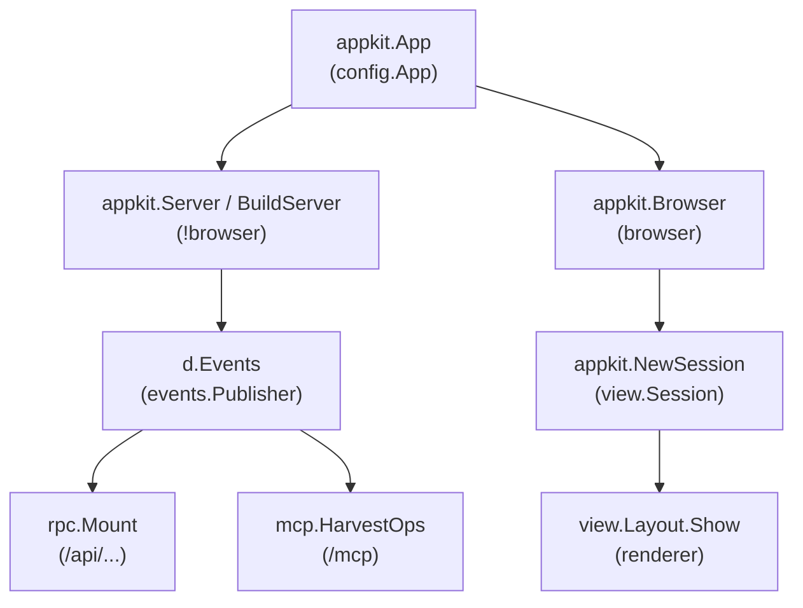
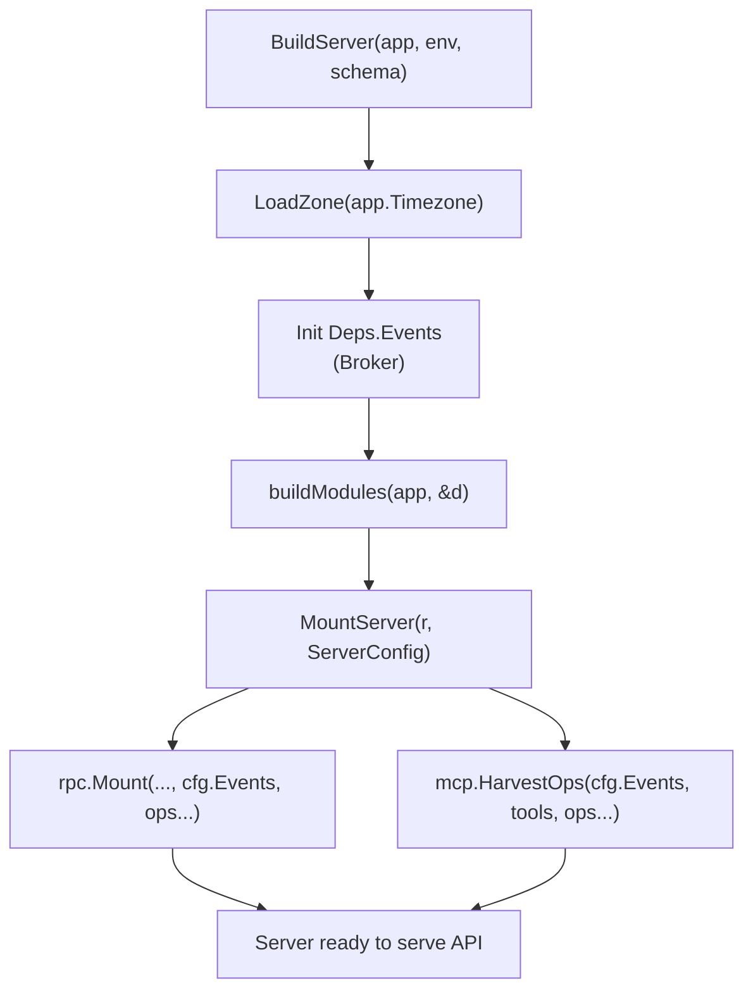

# webtyp/appkit Architecture

## 1. Overview in One Minute

`appkit` is the application kit for WebTyp: one [`App`](../app.go) value unites domain modules, access rules, server contracts, and user interface sessions into a unified application across both compilation targets (`web/server` and `web/browser`).

Instead of each application wiring servers, authentication fallbacks, permission verifications, and browser sessions manually, `appkit` joins these components by typed interfaces. It owns neither the database driver nor the UI layout: it delegates persistence to `storage.Conn` and rendering to [`view.Layout`](https://github.com/webtyp/view).

## 2. Repository Pieces & On-Disk Layout

`appkit` is isomorphic by default: common definitions reside in untagged files, while backend logic and frontend bootstrap isolate behind build tags.

| File | Destination | Responsibility |
|---|---|---|
| [`app.go`](../app.go) | All | Core application contracts: [`App`](../app.go), [`Module`](../app.go), and foundational error declarations. |
| [`server.go`](../server.go) | `!browser` | [`MountServer`](../server.go): mounts RPC endpoints, MCP tools, and extra mounts on `router.Router`. |
| [`serve.go`](../serve.go) | `!wasm` | [`Server`](../serve.go) and [`BuildServer`](../serve.go): HTTP server orchestration, leftovers validation, and boot sequence. |
| [`build_modules.go`](../build_modules.go) | `!wasm` | [`BuildModules`](../build_modules.go): builds module dependencies in transactional order for migrations and history imports. |
| [`app_server.go`](../app_server.go) | `!browser` | [`AppServer`](../app_server.go): server-only configuration (database opener, public endpoints, grants). |
| [`app_server_browser.go`](../app_server_browser.go) | `browser` | Empty [`AppServer`](../app_server_browser.go) stand-in to prevent server dependencies from compiling into browser WASM. |
| [`module_server.go`](../module_server.go) | `!browser` | [`ModuleServer`](../module_server.go), `Deps`, `Find`, `Entry`, and `Parts`. |
| [`module_server_browser.go`](../module_server_browser.go) | `browser` | Empty [`ModuleServer`](../module_server_browser.go) stand-in for client-side WASM. |
| [`screens.go`](../screens.go) | All | Extracts UI screens and entry screens from modules with zone injection. |
| [`session.go`](../session.go) | All | [`NewSession`](../session.go): compiles `view.Session` with a shared record pool for UI consumption. |
| [`browser.go`](../browser.go) | `browser` | [`Browser`](../browser.go): client bootstrap handing `view.Session` to chosen `view.Layout`. |
| [`brand.go`](../brand.go) / [`brand_ssr.go`](../brand_ssr.go) | All / `!wasm` | Access screen copy and SSR HTML pre-rendering. |

## 3. Step-by-Step Flows

### Server Mount and Transports Wiring

At server boot, `BuildServer` initializes the in-process event broker (`Deps.Events`) and hands it to `MountServer`:

1. **Broker Initialization:** `BuildServer` builds a local event broker for the application lifecycle.
2. **Module Construction:** Domain modules register entities and storage operations against the provided database.
3. **Transport Attachment:** `MountServer` passes `ServerConfig.Events` to both `rpc.Mount` and `mcp.HarvestOps`.
4. **Write Notification:** Stored entity writes via HTTP REST or MCP announce their commits over this broker to subscribers.

### Browser Session Initialization

In the browser client, `Browser` initializes the caller and compiles the presentation session:

1. **Caller & Records:** `NewSession` creates an `rpc.Caller` wrapped by `view.NewRecords()` so all screens share a single in-memory record cache.
2. **Screen Aggregation:** `Screens` and `EntryScreens` traverse `App.Modules`, supplying `view.BrowserDeps` containing the caller and loaded `time.Zone`.
3. **Layout Handoff:** `appkit.Browser` passes the compiled `view.Session` to the provided `view.Layout` and starts the event loop.

## 4. Security Boundaries & Contracts

- **Isomorphic Isolation:** Files importing database engines, migrations, or RPC server handlers are restricted to `!browser` builds. The browser binary compiles only `session.go`, `browser.go`, and empty server struct stand-ins, ensuring server internals never ship to client WASM.
- **Transports Broker Binding:** Writes committed through RPC or MCP must announce on the shared broker (`ServerConfig.Events`). If no broker is supplied (`nil`), writes proceed without event dispatch and without panic.
- **Closed Access by Default:** A nil `Authorize` configuration defaults to `DenyAll`, recording every unauthorized access attempt in logs. Public endpoints require explicit declaration in `AppServer.Public`.
- **Decoupled UI Layout:** `appkit` never imports concrete layout packages (`webtyp.com/layout`). Layouts consume `view.Session` via `view.Layout`, allowing apps to swap UI wrappers without altering appkit.
